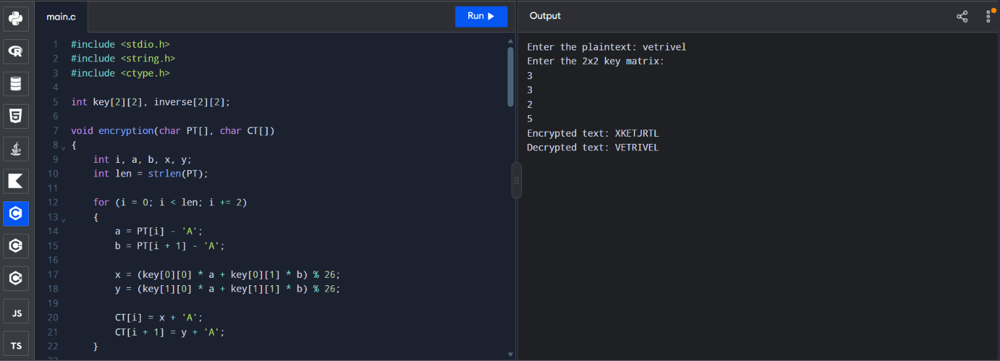

# HILL CIPHER
HILL CIPHER
EX. NO: 3 AIM:
 

IMPLEMENTATION OF HILL CIPHER
 
## To write a C program to implement the hill cipher substitution techniques.

### Name:M.Vetrivel
### Register Number: 212225040487
### Date: 28-10-2026

## DESCRIPTION:

Each letter is represented by a number modulo 26. Often the simple scheme A = 0, B
= 1... Z = 25, is used, but this is not an essential feature of the cipher. To encrypt a message, each block of n letters is  multiplied by an invertible n × n matrix, against modulus 26. To
decrypt the message, each block is multiplied by the inverse of the m trix used for
 
encryption. The matrix used
 
for encryption is the cipher key, and it sho
 
ld be chosen
 
randomly from the set of invertible n × n matrices (modulo 26).


## ALGORITHM:

STEP-1: Read the plain text and key from the user. STEP-2: Split the plain text into groups of length three. STEP-3: Arrange the keyword in a 3*3 matrix.
STEP-4: Multiply the two matrices to obtain the cipher text of length three.
STEP-5: Combine all these groups to get the complete cipher text.

## PROGRAM 
```c
#include <stdio.h>
#include <string.h>
#include <ctype.h>

int key[2][2], inverse[2][2];

void encryption(char PT[], char CT[])
{
    int i, a, b, x, y;
    int len = strlen(PT);

    for (i = 0; i < len; i += 2)
    {
        a = PT[i] - 'A';
        b = PT[i + 1] - 'A';

        x = (key[0][0] * a + key[0][1] * b) % 26;
        y = (key[1][0] * a + key[1][1] * b) % 26;

        CT[i] = x + 'A';
        CT[i + 1] = y + 'A';
    }

    CT[len] = '\0';
}

void decryption(char CT[], char DT[])
{
    int i, a, b, x, y;
    int len = strlen(CT);

    for (i = 0; i < len; i += 2)
    {
        a = CT[i] - 'A';
        b = CT[i + 1] - 'A';

        x = (inverse[0][0] * a + inverse[0][1] * b) % 26;
        y = (inverse[1][0] * a + inverse[1][1] * b) % 26;

        DT[i] = x + 'A';
        DT[i + 1] = y + 'A';
    }

    DT[len] = '\0';
}

int main()
{
    char PT[100], CT[100], DT[100];
    int i, j, det, invDet = -1;

    printf("Enter the plaintext: ");
    scanf("%99s", PT);

    for (i = 0; PT[i] != '\0'; i++)
        PT[i] = toupper((unsigned char)PT[i]);

    if (strlen(PT) % 2 != 0)
    {
        printf("Plaintext length must be even.\n");
        return 1;
    }

    printf("Enter the 2x2 key matrix:\n");

    for (i = 0; i < 2; i++)
        for (j = 0; j < 2; j++)
            scanf("%d", &key[i][j]);

    det = (key[0][0] * key[1][1] -
           key[0][1] * key[1][0]) % 26;

    if (det < 0)
        det += 26;

    for (i = 1; i < 26; i++)
    {
        if ((det * i) % 26 == 1)
        {
            invDet = i;
            break;
        }
    }

    if (invDet == -1)
    {
        printf("Invalid key matrix. Decryption is not possible.\n");
        return 1;
    }

    inverse[0][0] = key[1][1];
    inverse[0][1] = -key[0][1];
    inverse[1][0] = -key[1][0];
    inverse[1][1] = key[0][0];

    for (i = 0; i < 2; i++)
    {
        for (j = 0; j < 2; j++)
        {
            inverse[i][j] = (inverse[i][j] * invDet) % 26;

            if (inverse[i][j] < 0)
                inverse[i][j] += 26;
        }
    }

    encryption(PT, CT);
    printf("Encrypted text: %s\n", CT);

    decryption(CT, DT);
    printf("Decrypted text: %s\n", DT);

    return 0;
}

```

## OUTPUT



## RESULT

The C program to implement the hill cipher substitution techniques is completed sucessfully. 
